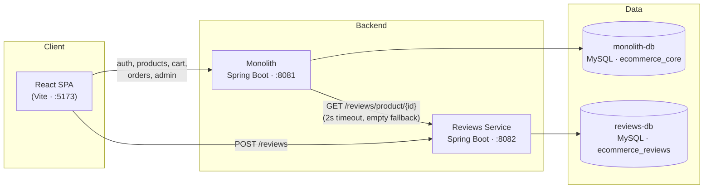
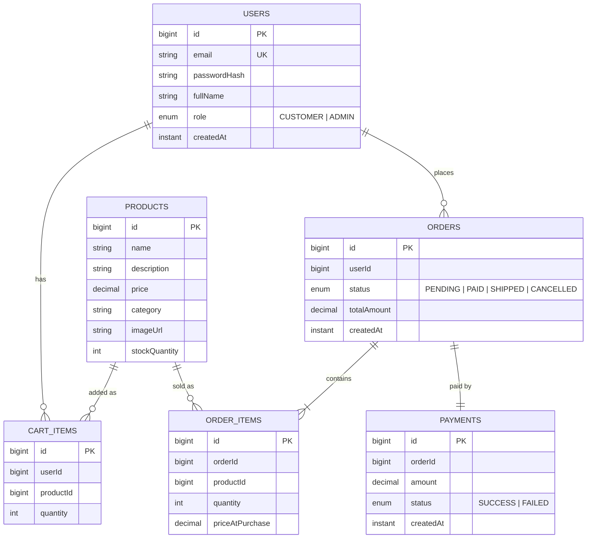

# IUTMarketPlace

A full-stack e-commerce platform built with **Spring Boot**, **React**, and **MySQL**. It uses a pragmatic hybrid architecture: a modular **monolith** holds the core commerce domain, and a separate **Reviews & Ratings microservice** runs alongside it with its own database. The two share one stateless JWT authentication scheme.


---

## Table of Contents

- [Features](#features)
- [Architecture](#architecture)
- [Tech Stack](#tech-stack)
- [Project Structure](#project-structure)
- [Getting Started](#getting-started)
- [Configuration](#configuration)
- [API Reference](#api-reference)
- [Authentication & Authorization](#authentication--authorization)
- [Data Model](#data-model)
- [Checkout Flow](#checkout-flow)
- [Design Decisions](#design-decisions)
- [Known Limitations](#known-limitations)
- [Team](#team)

---

## Features

### Customers
- Register and log in with email and password (JWT-based sessions)
- Browse the product catalog, filter by category, and sort by price (ascending or descending)
- View product details with stock status, customer reviews, and average rating
- Add products to a persistent, server-side shopping cart and remove them
- Check out in one step: stock is reserved, a (mock) payment is charged, and an order is created
- View order history and per-order details with live status (`PENDING`, `PAID`, `SHIPPED`, `CANCELLED`)
- Leave a 1–5 star rating and an optional comment on any product

### Administrators
- Admin dashboard with **Products** and **Orders** tabs
- Create, edit, and delete products (name, description, price, category, image URL, stock)
- View every order in the system and update its status
- Shopping-only UI (cart, checkout, review form, "My Orders") is hidden for admin accounts

### Platform
- Stateless JWT authentication shared across both backend services
- Role-based access control (`CUSTOMER` / `ADMIN`) enforced on the server and mirrored in the UI
- Graceful degradation: product pages still load if the reviews service is down
- Interactive OpenAPI / Swagger UI for both services
- One-command backend startup with Docker Compose

---

## Architecture



| Component | Responsibility | Host port |
|---|---|---|
| **Monolith** | Users & auth (issues JWTs), products, cart, inventory, orders, mock payments, admin | `8081` |
| **Reviews Service** | Product reviews & ratings; validates monolith-issued JWTs (does not issue its own) | `8082` |
| **monolith-db** | MySQL 8.4, schema `ecommerce_core` | `3309` |
| **reviews-db** | MySQL 8.4, schema `ecommerce_reviews` | `3308` |
| **Frontend** | React single-page app | `5173` (dev server) |

**How the services talk to each other**

- The frontend calls the **monolith** for everything except submitting reviews, which it sends **directly to the reviews service**.
- When a product detail page is requested, the monolith calls the reviews service over REST and merges the reviews and average rating into one response. That call has 2-second connect/read timeouts and falls back to an empty review list, so a reviews outage never breaks the product page.
- Both services sign and verify tokens with the same `JWT_SECRET`. The reviews service trusts the `userId` claim in the token and has no user table of its own.

---

## Tech Stack

| Layer | Technologies |
|---|---|
| **Backend** | Java 17, Spring Boot 3.5.3, Spring Web, Spring Data JPA (Hibernate), Spring Security, Bean Validation, Lombok |
| **Auth** | JJWT 0.12.6 (HMAC-SHA signed JWTs), BCrypt password hashing |
| **API docs** | springdoc-openapi 2.6.0 (Swagger UI) |
| **Database** | MySQL 8.4 (one database per service) |
| **Frontend** | React 19, React Router 7, Axios, Tailwind CSS 4, Lucide icons, Vite 8, Oxlint |
| **DevOps** | Docker (multi-stage builds on Eclipse Temurin 17), Docker Compose, Maven Wrapper |

---

## Project Structure

```
.
├── docker-compose.yml          # MySQL x2 + monolith + reviews-service
├── .env.example                # DB_PASSWORD, JWT_SECRET
│
├── monolith/                   # Core commerce service (Spring Boot)
│   ├── Dockerfile
│   ├── pom.xml
│   └── src/main/java/com/xyz/ecommerce/
│       ├── auth/               # Register/login, JwtService, JWT filter, SecurityConfig, OpenAPI config
│       ├── user/               # User entity (implements UserDetails), Role enum
│       ├── product/            # Product CRUD, filtering/sorting, ReviewsClient (calls reviews-service)
│       ├── cart/               # Per-user cart items
│       ├── inventory/          # Stock checks and decrements
│       ├── order/              # Checkout, order history, status updates
│       ├── payment/            # Mock payment processor
│       └── admin/              # Admin-only listing endpoints
│
├── reviews-service/            # Reviews & ratings microservice (Spring Boot)
│   ├── Dockerfile
│   ├── pom.xml
│   └── src/main/java/com/xyz/reviews/
│       ├── review/             # Review entity, controller, service, average-rating query
│       └── security/           # JwtValidator (verify-only), JWT filter, SecurityConfig, OpenAPI config
│
└── frontend/                   # React SPA (Vite + Tailwind)
    ├── .env.example            # VITE_API_BASE_URL, VITE_REVIEWS_API_BASE_URL
    └── src/
        ├── api/                # Axios clients (monolith + reviews) and per-resource API modules
        ├── context/            # AuthContext (JWT decoding), CartContext (shared cart state)
        ├── components/         # Navbar, ProductCard, ProtectedRoute
        └── pages/              # Products, Product detail, Login, Register, Cart, Orders, Admin
```

The monolith is organized **by feature**, with one package per bounded context. Each package holds its own controller, service, repository, entities, and DTOs, so any module can be split into its own service later with little rework.

---

## Getting Started

### Prerequisites

- [Docker](https://docs.docker.com/get-docker/) and Docker Compose
- [Node.js](https://nodejs.org/) 20.19+ (or 22.12+) and npm, for the frontend
- *(Optional, for running backends without Docker)* JDK 17

### 1. Clone the repository

```bash
git clone <repository-url>
cd <repository-folder>
```

### 2. Configure environment variables

```bash
cp .env.example .env
cp frontend/.env.example frontend/.env
```

The defaults work for local development. Change `DB_PASSWORD` and `JWT_SECRET` before deploying anywhere shared (see [Configuration](#configuration)).

### 3. Start the backend stack

```bash
docker compose up --build
```

This builds and starts four containers: `monolith-db`, `reviews-db`, `monolith`, and `reviews-service`. Hibernate creates the database tables automatically on first boot.

> The services start in parallel with their databases. If a service exits because MySQL wasn't ready yet, it restarts on its own (`restart: unless-stopped`) and connects on the next attempt.

### 4. Start the frontend

```bash
cd frontend
npm install
npm run dev
```

Open **http://localhost:5173**.

### 5. Explore the APIs

| Service | Swagger UI |
|---|---|
| Monolith | http://localhost:8081/swagger-ui.html |
| Reviews Service | http://localhost:8082/swagger-ui.html |

To call protected endpoints from Swagger, get a token from `POST /auth/login`, click **Authorize**, and paste the token.

### 6. Create an admin account

New registrations always get the `CUSTOMER` role. To make an admin, register a normal account, then promote it in the database:

```bash
docker exec -it monolith-db mysql -uroot -ppassword ecommerce_core -e "UPDATE users SET role='ADMIN' WHERE email='you@example.com';"
```

Replace `password` with your `DB_PASSWORD` if you changed it. **Log out and log back in** afterwards: the role is embedded in the JWT, so the old token still says `CUSTOMER`. An **Admin** link then appears in the navbar.

### Running backends without Docker (optional)

Start the two MySQL containers only, then run each service with the Maven Wrapper, pointing it at the host-mapped ports:

```bash
docker compose up -d monolith-db reviews-db
```

```bash
cd reviews-service
DB_PORT=3308 ./mvnw spring-boot:run
```

```bash
cd monolith
DB_PORT=3309 SERVER_PORT=8081 REVIEWS_SERVICE_URL=http://localhost:8082 ./mvnw spring-boot:run
```

`SERVER_PORT=8081` keeps the monolith on the port the frontend expects. `REVIEWS_SERVICE_URL` is required here because its default (`http://reviews-service:8082`) only resolves inside the Docker network. On Windows PowerShell, set each variable first with `$env:NAME="value"`.

### Useful commands

| Task | Command |
|---|---|
| Stop the stack | `docker compose down` |
| Stop and **delete all data** | `docker compose down -v` |
| Follow service logs | `docker compose logs -f monolith reviews-service` |
| Production frontend build | `cd frontend && npm run build` |
| Lint the frontend | `cd frontend && npm run lint` |
| Run backend tests* | `cd monolith && ./mvnw test` |

\*The current test suite is a Spring context-load smoke test and needs a reachable MySQL instance.

---

## Configuration

### Backend (root `.env`, read by Docker Compose)

| Variable | Default | Description |
|---|---|---|
| `DB_PASSWORD` | `password` | MySQL root password for both databases |
| `JWT_SECRET` | dev-only placeholder | HMAC signing key shared by **both** services. It must be at least 32 bytes and identical in both, or the reviews service will reject the monolith's tokens. |

### Additional service properties

These can be set as environment variables when running a service directly:

| Variable | Service | Default | Description |
|---|---|---|---|
| `DB_HOST` / `DB_PORT` / `DB_NAME` / `DB_USER` | both | `localhost` / `3306` / per-service / `root` | Database connection |
| `JWT_EXPIRATION_MS` | monolith | `86400000` (24 h) | Token lifetime |
| `REVIEWS_SERVICE_URL` | monolith | `http://reviews-service:8082` | Base URL of the reviews service |

### Frontend (`frontend/.env`)

| Variable | Default | Description |
|---|---|---|
| `VITE_API_BASE_URL` | `http://localhost:8081` | Monolith base URL |
| `VITE_REVIEWS_API_BASE_URL` | `http://localhost:8082` | Reviews service base URL |

---

## API Reference

🔓 public · 🔑 any logged-in user · 🛡️ admin only

### Monolith (`http://localhost:8081`)

#### Auth
| Method | Endpoint | Access | Description |
|---|---|---|---|
| `POST` | `/auth/register` | 🔓 | Create a customer account → `{ token }` |
| `POST` | `/auth/login` | 🔓 | Log in → `{ token }` |

<details>
<summary>Request bodies</summary>

```jsonc
// POST /auth/register
{ "email": "jane@example.com", "password": "min8chars", "fullName": "Jane Doe" }

// POST /auth/login
{ "email": "jane@example.com", "password": "min8chars" }
```
</details>

#### Products
| Method | Endpoint | Access | Description |
|---|---|---|---|
| `GET` | `/products?category=&sort=` | 🔓 | List products. `sort` = `price` (asc) or `price_desc` |
| `GET` | `/products/{id}` | 🔓 | Product detail including `reviews[]` and `averageRating` |
| `POST` | `/products` | 🛡️ | Create a product |
| `PUT` | `/products/{id}` | 🛡️ | Update a product |
| `DELETE` | `/products/{id}` | 🛡️ | Delete a product |

<details>
<summary>Product request body</summary>

```json
{
  "name": "Mechanical Keyboard",
  "description": "Hot-swappable, RGB",
  "price": 79.99,
  "category": "accessories",
  "imageUrl": "https://example.com/keyboard.jpg",
  "stockQuantity": 25
}
```
</details>

#### Cart
| Method | Endpoint | Access | Description |
|---|---|---|---|
| `GET` | `/cart` | 🔑 | The current user's cart items with line totals |
| `POST` | `/cart/items` | 🔑 | Add `{ productId, quantity }`. Adding an item that's already in the cart increases its quantity. |
| `DELETE` | `/cart/items/{id}` | 🔑 | Remove a cart item |

#### Orders
| Method | Endpoint | Access | Description |
|---|---|---|---|
| `POST` | `/orders` | 🔑 | Check out the current cart |
| `GET` | `/orders` | 🔑 | The current user's order history |
| `GET` | `/orders/{id}` | 🔑 | Order detail (owner or admin only) |
| `PUT` | `/orders/{id}/status` | 🛡️ | Update status: `{ "status": "SHIPPED" }` |

#### Admin
| Method | Endpoint | Access | Description |
|---|---|---|---|
| `GET` | `/admin/products` | 🛡️ | All products |
| `GET` | `/admin/orders` | 🛡️ | All orders from all users |

### Reviews Service (`http://localhost:8082`)

| Method | Endpoint | Access | Description |
|---|---|---|---|
| `GET` | `/reviews/product/{productId}` | 🔓 | `{ reviews[], averageRating }` |
| `POST` | `/reviews` | 🔑 | Submit `{ productId, rating (1–5), comment }` |

### Error semantics

| Status | Meaning |
|---|---|
| `400` | Validation failure or empty cart at checkout |
| `401` | Missing, invalid, or expired token. The frontend clears the session and redirects to `/login`. |
| `403` | Authenticated but not allowed (wrong role, or someone else's order) |
| `404` | Product, cart item, or order not found |
| `409` | Email already registered, or not enough stock at checkout |

---

## Authentication & Authorization

1. On register or login, the monolith hashes or verifies the password with **BCrypt** and returns a signed JWT containing:
   - `sub`: the user's email
   - `userId`: the numeric user ID
   - `role`: `CUSTOMER` or `ADMIN`
   - `iat` / `exp`: issue and expiry times (24 h by default)
2. The frontend stores the token in `localStorage`, attaches it as `Authorization: Bearer <token>` to every request, and decodes it locally to read the email, role, and user ID. No `/me` endpoint is needed.
3. **Monolith:** a `OncePerRequestFilter` validates the token, loads the user, and sets the Spring Security context. Authorization combines URL rules (`/admin/**` requires `ADMIN`) with method-level `@PreAuthorize` checks.
4. **Reviews service:** validates the signature with the shared secret and uses the `userId` claim as the principal. It never issues tokens.
5. Both services are fully stateless (no HTTP sessions, CSRF disabled) and allow CORS from any `http://localhost:*` origin.

On the client, `ProtectedRoute` guards `/cart`, `/orders`, and `/orders/:id` (login required) and `/admin` (admin required). The server enforces the same rules independently.

---

## Data Model



The **reviews** database (`ecommerce_reviews`) holds a single `reviews` table: `id`, `productId`, `userId`, `rating` (1–5), `comment`, `createdAt`. Its `productId` and `userId` refer to monolith records by ID only. Because the two tables live in different databases, there are no foreign keys between them.

Entities reference each other by ID rather than JPA associations, which keeps the modules loosely coupled. `priceAtPurchase` is captured on each order item, so later price changes don't rewrite order history.

---

## Checkout Flow

`POST /orders` runs inside a single database transaction:

1. Load the user's cart. If it's empty, return `400`.
2. For each item, check stock and decrement it. If any item lacks stock, return `409` and roll back the whole order.
3. Create the order (`PENDING`) and its order items, recording the current prices.
4. Charge the **mock payment** (always succeeds) and record a `Payment` row.
5. Set the order to `PAID` (or `CANCELLED` if the payment failed).
6. Clear the cart and return the order.

An admin can then move the order to `SHIPPED` or `CANCELLED` from the dashboard, and the customer sees the new status on their orders page.

---

## Design Decisions

- **Monolith + one microservice, by design.** Reviews were extracted because they have a genuinely independent lifecycle: no shared transactions with orders, not on the checkout path, and a distinct read/write pattern. Everything else stays in the monolith, which avoids distributed-transaction complexity where it adds no value.
- **No API gateway, service discovery, or message broker.** With two deployables, a configured URL and one REST call are simpler and easier to reason about.
- **Database per service.** Each service owns its schema and can be deployed, scaled, or replaced on its own.
- **Fault-tolerant service call.** Short timeouts plus an empty fallback mean a reviews outage degrades the product page instead of breaking it.
- **Distinct 401 vs 403.** A custom authentication entry point returns `401` for unauthenticated requests, so the frontend can tell "please log in" apart from "not allowed".

---

## Known Limitations

This is an academic project with deliberately trimmed scope. These are known trade-offs rather than oversights:

- **Payment is mocked.** No real gateway, webhooks, or retries; every charge succeeds.
- **Naive inventory.** Stock is decremented without locking, so simultaneous checkouts of the last unit could oversell.
- **No admin bootstrap.** Admins have to be promoted manually in the database (see [step 6](#6-create-an-admin-account)).
- **Reviews are not cross-validated.** The reviews service doesn't check that the product exists, and one user can review the same product more than once.
- **Schema management** uses Hibernate `ddl-auto=update` rather than versioned migrations (Flyway or Liquibase).
- **Tokens live in `localStorage`** and can't be revoked before they expire. There are no refresh tokens.
- **CORS is restricted to `localhost`**, so deploying anywhere else requires updating both `SecurityConfig` classes.
- **The frontend isn't containerized.** It runs with the Vite dev server or as a static build.
- **Minimal automated tests.** Only Spring context-load tests exist so far.

---

## Team

| Name | Student ID |
|---|---|
| A K M Ferdous Reza Habib | 220041138 |
| Shadab Bin Habib | 220041201 |
| Isfak Iqbal Chowdhury | 220041213 |
